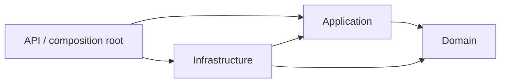
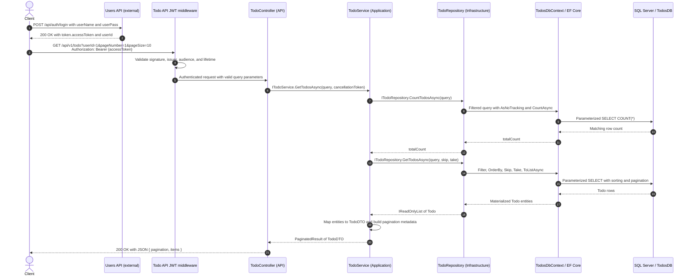

# Todo List API

A todo and category REST API built with C#, ASP.NET Core 10, Entity Framework Core, SQL Server, JWT authentication, and Swagger, following Clean Architecture.

## Project structure

```text
portfolio-todo-rest-api/
├── Controllers/                         # HTTP routes and application-result mapping
│   ├── TodoController.cs
│   ├── CategoryController.cs
│   └── ControllerResultExtensions.cs
├── ApiExceptionHandler.cs               # Exceptions -> HTTP Problem Details
├── Program.cs                           # Composition root and middleware pipeline
├── appsettings.json                     # Public defaults and configuration placeholders
├── Properties/launchSettings.json       # Local HTTP/HTTPS launch profiles
├── src/
│   ├── Domain/
│   │   └── Entities/                    # Todo and Category; no framework dependencies
│   ├── Application/
│   │   ├── DependencyInjection/          # AddApplication()
│   │   ├── Common/                      # Results, errors, pagination, persistence exceptions
│   │   ├── Todos/                       # Service/repository contracts, service, DTOs
│   │   └── Categories/                  # Service/repository contracts, service, DTOs
│   └── Infrastructure/
│       ├── DependencyInjection/          # AddInfrastructure(configuration)
│       └── Persistence/                 # TodosDbContext and EF repository implementations
├── SQL/                                 # Schema and optional sample-data scripts
├── docs/clean-architecture.md            # Detailed request and write workflows
├── tests/
│   ├── UnitTests/                       # Application services with fake repositories
│   ├── IntegrationTests/                # HTTP/JWT checks and persistence-error translation
│   ├── manual-tests/                    # Todo and category .http requests
│   └── postman/                         # Todo collection and local environment
└── portfolio-todo-rest-api.slnx             # API, three layer projects, and two test projects
```

## Clean architecture

The dependency rule keeps business workflows independent of HTTP and the database provider. Each layer has a specific responsibility:

| Layer | Responsibility | Examples |
| --- | --- | --- |
| **API** (root web project) | Bind/validate HTTP inputs, validate JWTs, call application services, serialize DTOs, choose status codes | Controllers, middleware, `ApiExceptionHandler` |
| **Application** | Coordinate use cases, check references, map entities to DTOs, describe persistence contracts | `TodoService`, `CategoryService`, `ITodoRepository`, `Result<T>` |
| **Domain** | Represent the core data without ASP.NET Core or EF Core dependencies | `Todo`, `Category` |
| **Infrastructure** | Implement repositories and translate between entities and SQL Server | `TodoRepository`, `CategoryRepository`, `TodosDbContext` |

These arrows show **project references**, not the order of execution:



`Application` declares the repository interfaces; `Infrastructure` implements them. The application service calls an interface at runtime, so it does not need a reference to EF Core or SQL Server. The API references Infrastructure to register implementations in `Program.cs`; controllers depend on application interfaces.

This is a small, practical implementation: entities currently hold data, services own use-case behavior, and DTO validation uses Data Annotations. Application registration uses the generic .NET DI abstractions; it does not reference ASP.NET Core or EF Core. There is no separate mediator or generic repository layer.

### Happy path: authenticate and retrieve todos

Login belongs to the separate **`portfolio-users-rest-api`** service. This API validates the issued token locally on each request; it does not call the Users API or read its database.



The two repository calls execute sequentially: one counts matching rows and one fetches the requested page. EF materializes the SQL results into domain entities, the service maps them to DTOs, and ASP.NET Core serializes those DTOs to JSON. See [the detailed architecture guide](docs/clean-architecture.md) for write operations and failure paths.

## Dependency injection

`Program.cs` is the **composition root**: it connects each contract to its implementation and configures controllers, Swagger, authentication, authorization, and error handling.

```csharp
builder.Services.AddApplication();
builder.Services.AddInfrastructure(builder.Configuration);
```

| Contract / component | Implementation | Lifetime | Registered by |
| --- | --- | --- | --- |
| `ITodoService` | `TodoService` | Scoped | `AddApplication()` |
| `ICategoryService` | `CategoryService` | Scoped | `AddApplication()` |
| `TimeProvider` | `TimeProvider.System` | Singleton | `AddApplication()`; preserves a pre-registered provider |
| `ITodoRepository` | `TodoRepository` | Scoped | `AddInfrastructure(...)` |
| `ICategoryRepository` | `CategoryRepository` | Scoped | `AddInfrastructure(...)` |
| `TodosDbContext` | EF Core context with `UseSqlServer(...)` | Scoped | `AddInfrastructure(...)` |

A scoped instance is reused within one HTTP request. Both repositories therefore share the request's `TodosDbContext`; the next request receives a different context. `TimeProvider` is shared and lets application tests supply a predictable clock. Controllers and services receive dependencies through their constructors.

The middleware pipeline wraps requests with exception handling, redirects to HTTPS when configured, authenticates the JWT, then applies authorization before executing controllers. Swagger is enabled only in Development.

## Models and data contracts

Domain **entities** describe persisted data. Application **DTOs** describe accepted inputs and returned JSON, so controllers do not expose tracked EF entities or navigation properties.

| Model | Purpose |
| --- | --- |
| `Todo` | Todo identity, content, category/user references, completion/archive state, and timestamps |
| `Category` | Caller-assigned category ID, name, and a collection of todos |
| `TodoForPostDTO` / `TodoForPutDTO` | Create/update input; PUT includes `TodoId`, completion, and archive state |
| `TodoArchivePatchDTO` / `TodoCompletePatchDTO` | Set one boolean state |
| `TodoDTO` | Returned todo fields without navigation properties |
| `CategoryForPostDTO` / `CategoryForPutDTO` | Category ID and name input |
| `CategoryDTO` | Category ID and name output |
| `TodoPaginationQuery` | Pagination, optional filters, search, and ordering |
| `PaginatedResult<T>` / `Result<T>` | Page metadata/items, or a successful value/application failure |

Todo input requires a name (up to 100 characters), description (up to 500), and positive category/user IDs. Category input requires a positive ID and a name up to 80 characters. `[ApiController]` enforces the Data Annotations before the service runs. PUT requires the body ID to match the route ID. Creating or updating a todo also checks that its category exists.

`UserId` is an integer reference to an external user. This service does not verify that the user exists, derive ownership from JWT claims, or enforce per-user access. The optional `userId` query parameter filters results; omitting it returns todos across users to any authenticated caller.

## Entity Framework Core and SQL Server

`AddInfrastructure(...)` reads `ConnectionStrings:TodosDBConn` and registers:

```csharp
services.AddDbContext<TodosDbContext>(options => options.UseSqlServer(connectionString));
services.AddScoped<ITodoRepository, TodoRepository>();
services.AddScoped<ICategoryRepository, CategoryRepository>();
```

`TodosDbContext` exposes `DbSet<Todo> Todos` and `DbSet<Category> Categories`. Its `OnModelCreating` Fluent API defines keys, lengths, SQL types, and the category foreign key. EF Core translates repository LINQ expressions into SQL and materializes query results into entities.

- **Reads:** repositories use `AsNoTracking()`. Filtering, text search, counting, sorting, and `Skip`/`Take` pagination execute in SQL Server. Categories are returned as a list ordered by ID.
- **Writes:** repositories load tracked entities with `FindAsync`, add or remove entities, and persist through `SaveChangesAsync`. EF detects changed properties and issues `INSERT`, `UPDATE`, or `DELETE` statements. One save is transactional by default.
- **Errors:** the context converts EF update/concurrency exceptions into application-defined persistence exceptions. The API handler maps these to `409` Problem Details without depending on EF types or exposing database messages. Other unexpected exceptions produce `500`.
- **Cancellation:** request cancellation tokens pass through controllers, services, repositories, and EF calls.

### Database schema

The supplied scripts target `TodosDB` and create two tables:

| Table | Columns / mapping |
| --- | --- |
| `dbo.Category` | `CategoryId int` primary key, supplied by the caller; `Name varchar(80)` required |
| `dbo.Todos` | `TodoId int IDENTITY` primary key; `Name nvarchar(100)` and `Description varchar(max)` required |
| `dbo.Todos` references | `CategoryId int` required FK to `Category`; `UserId int` required with no local user FK |
| `dbo.Todos` state | `IsComplete bit` and `IsArchived bit` required |
| `dbo.Todos` dates | `DateCreated` / `DateModified` required; `DatetimeReminder` / `DateArchived` nullable; all use SQL `datetime` |

The category foreign key uses **cascade delete**: deleting a category also deletes its todos. Application-created timestamps currently use `TimeProvider.GetUtcNow().UtcDateTime`. SQL `datetime` stores no timezone/offset; reminder input is stored as provided.

Schema setup uses the checked-in [SQL scripts](SQL). There are no checked-in EF migrations and startup does not create or migrate the database.

## Authentication and configuration

All mapped controller endpoints require a valid bearer token through the authorization fallback policy. Development Swagger UI is available separately at `/swagger`.

The checked-in JWT issuer and audience are:

```json
{
  "Jwt": {
    "Issuer": "portfolio-users-rest-api",
    "Audience": "portfolio-todo-rest-api"
  }
}
```

Supply `Jwt:SigningKey` securely and match the key used by the token issuer. Validation checks the signature, issuer, audience, and expiry, with one minute of clock skew. This service has no login or token-issuing endpoint.

ASP.NET Core configuration allows environment variables to override JSON values; nested keys use `__`:

```bash
export ConnectionStrings__TodosDBConn='Server=localhost,1433;Database=TodosDB;User ID=sa;Password=<your-password>;Encrypt=True;TrustServerCertificate=True'
export Jwt__Issuer='portfolio-users-rest-api'
export Jwt__Audience='portfolio-todo-rest-api'
export Jwt__SigningKey='<shared-signing-key-at-least-32-bytes>'
```

The committed `appsettings.json` contains public defaults and placeholders. Set real values with the environment variables above, or put development overrides in `appsettings.Development.json`, which Git ignores and ASP.NET Core loads automatically with the Development launch profiles. Environment variables take precedence over JSON settings. Configure the same signing key in the Users API.

Keep credentials and signing keys out of committed files. Local environment settings, private Postman exports, certificates, database backups, and generated build output are excluded by `.gitignore`. The connection example trusts a local development certificate; use an appropriately configured certificate for deployment.

## Running locally

1. Install the .NET 10 SDK and make SQL Server available locally or remotely. A container running SQL Server is another option where supported by your host.
2. In SQL Server, create/select the database before running the table scripts:

   ```sql
   CREATE DATABASE TodosDB;
   GO
   USE TodosDB;
   GO
   ```

3. Run these scripts against `TodosDB` in order:
   - [Category table](SQL/Category-table-creation.sql)
   - [Todos table](SQL/Todos-table-creation.sql)
   - Optional [category sample data](SQL/Category-table-population.sql), then [todo sample data](SQL/Todos-table-population.sql)
4. Set the connection/JWT environment variables above. Configure the separate Users API with the same signing key, matching issuer, and an audience containing `portfolio-todo-rest-api`.
5. Restore, build, and start the Todo API:

   ```bash
   dotnet restore portfolio-todo-rest-api.slnx
   dotnet build portfolio-todo-rest-api.slnx --no-restore
   dotnet run --project portfolio-todo-rest-api.csproj --launch-profile http
   ```

The HTTP profile serves `http://localhost:5002`; open `http://localhost:5002/swagger`. The HTTPS profile uses `https://localhost:7132` (with a trusted development certificate). If both APIs run locally, give their HTTPS listeners different ports: their current default HTTPS profiles both use `7132`.

### Authenticate, then request a page

Start the separate Users API; its HTTP profile uses port `5001`. Authenticate with an existing user:

```bash
curl --request POST 'http://localhost:5001/api/auth/login' \
  --header 'Content-Type: application/json' \
  --data '{"userName":"<your-user>","userPass":"<your-password>"}'
```

Copy `token.accessToken` from that response and use the returned `userId` as the filter:

```bash
export TODO_ACCESS_TOKEN='<token.accessToken from login>'
curl 'http://localhost:5002/api/v1/todo?userId=1&pageNumber=1&pageSize=10' \
  --header "Authorization: Bearer $TODO_ACCESS_TOKEN"
```

In Swagger's **Authorize** dialog, enter the token value without the `Bearer` prefix.

### Postman bearer authentication

Import the [Todo collection](tests/postman/todo-controller.postman_collection.json) and [local environment](tests/postman/local.postman_environment.json), then select **Todo List API - Local**. Set `userName` and `userPass` in Postman and send **Login - Users API** to save the access token and user ID automatically. You can also set `todo_bearer_token` to the raw `token.accessToken` string from a separate login. The collection accepts the `accessToken` variable as a fallback.

Every Todo request includes an explicit `Authorization: Bearer {{todo_bearer_token}}` header. A collection pre-request script resolves the token, removes an optional pasted `Bearer` prefix, and reports missing, malformed, expired, or mismatched tokens. The API validates the signature and claims.

The committed Postman environment is a template with blank credentials and tokens. Keep those values blank in the repository. Store private exports under `tests/postman/private/` or use a filename ending in `.private.postman_environment.json`; Git ignores both locations.

For a request created manually in Postman, open **Authorization**, choose **Bearer Token**, and enter the raw access token. Postman must send exactly one header in this form:

```http
Authorization: Bearer eyJ...
```

Check **Code > cURL** or the Postman Console to confirm that header is present. A request containing only `Accept: application/json` is anonymous and correctly returns `401`. If `WWW-Authenticate` includes `error="invalid_token"`, check token expiry, issuer, audience, and signature. GET requests need no body.

## CRUD operations

### Todos

| Method | Route | Success | Behavior |
| --- | --- | --- | --- |
| `GET` | `/api/v1/todo` | `200` | Paginated, optionally filtered todos |
| `GET` | `/api/v1/todo/{id}` | `200` | One todo |
| `POST` | `/api/v1/todo` | `201` + `Location` header | Create; completion/archive default to false; timestamps set by the service |
| `PUT` | `/api/v1/todo/{id}` | `200` | Replace editable fields; return updated DTO |
| `PATCH` | `/api/v1/todo/{id}/complete` | `200` | Set completion using `{ "isComplete": true }` or `false` |
| `PATCH` | `/api/v1/todo/{id}/archive` | `200` | Set archive state/date using `{ "isArchived": true }` or `false` |
| `DELETE` | `/api/v1/todo/{id}` | `204` | Permanently delete |

Create example, using an existing category:

```json
{
  "name": "Buy groceries",
  "description": "Milk, bread, coffee",
  "datetimeReminder": null,
  "categoryId": 1003,
  "userId": 1
}
```

PUT example (`/api/v1/todo/1`):

```json
{
  "todoId": 1,
  "name": "Buy groceries",
  "description": "Milk, bread, coffee",
  "isComplete": true,
  "datetimeReminder": null,
  "categoryId": 1003,
  "userId": 1,
  "isArchived": false
}
```

### Categories

| Method | Route | Success | Behavior |
| --- | --- | --- | --- |
| `GET` | `/api/v1/category` | `200` | Array ordered by category ID; no pagination |
| `GET` | `/api/v1/category/{id}` | `200` | One category |
| `POST` | `/api/v1/category` | `201` + `Location` header | Create with a caller-supplied unique ID |
| `PUT` | `/api/v1/category/{id}` | `200` | Update the name; body ID must match route |
| `DELETE` | `/api/v1/category/{id}` | `204` | Delete the category and its todos through the FK cascade |

POST/PUT payload:

```json
{ "categoryId": 1004, "name": "Work" }
```

### Todo pagination, filtering, and ordering

| Query parameter | Default | Behavior |
| --- | --- | --- |
| `pageNumber` | `1` | Positive integer |
| `pageSize` | `10` | Between `1` and `100` |
| `isComplete`, `isArchived` | None | Optional boolean filters |
| `categoryId`, `userId` | None | Optional integer equality filters |
| `search` | None | Trimmed substring search in name or description |
| `sortBy` | `todoId` | `todoId`, `name`, `dateCreated`, `dateModified`, `isComplete`, `isArchived`, `categoryId`, `userId`; unrecognized values fall back to `todoId` |
| `sortDirection` | `Asc` | `Asc` or `Desc` |

Sorting by another field uses `TodoId` as a tie-breaker. The count and page use the same filters. A page beyond the available data returns an empty `items` array.

Example response (one matching todo):

```json
{
  "pagination": {
    "pageNumber": 1,
    "pageSize": 10,
    "totalCount": 1,
    "totalPages": 1,
    "hasPreviousPage": false,
    "hasNextPage": false
  },
  "items": [
    {
      "todoId": 1,
      "name": "Buy groceries",
      "description": "Milk, bread, coffee",
      "isComplete": false,
      "datetimeReminder": null,
      "categoryId": 1003,
      "userId": 1,
      "dateCreated": "2026-10-28T10:00:00",
      "dateModified": "2026-10-28T10:00:00",
      "isArchived": false,
      "dateArchived": null
    }
  ]
}
```

### Failure responses

| Status | When |
| --- | --- |
| `400 Bad Request` | Invalid model/query, route/body ID mismatch, or a missing referenced category |
| `401 Unauthorized` | Missing, invalid, or expired JWT; the request does not reach the application service |
| `404 Not Found` | A requested todo/category does not exist |
| `409 Conflict` | Duplicate category ID or a persistence/concurrency conflict |
| `500 Internal Server Error` | Unexpected unhandled failure |

Application, validation, and unhandled errors use Problem Details (`application/problem+json`). Validation errors include an `errors` dictionary; validation and exception responses also include a `traceId`. Bearer authentication failures can have an empty body.

## Verification and manual requests

```bash
dotnet test portfolio-todo-rest-api.slnx
```

- **Unit tests** run real application services with fake repositories and a fixed clock.
- **HTTP integration tests** run the ASP.NET Core pipeline and JWT validation, substituting fake application services. Their JWT settings are isolated from deployment settings.
- **Persistence-error tests** run the real EF context with a save interceptor to verify exception translation, `409` Problem Details, and cancellation propagation without contacting SQL Server.

The automated suite does not prove SQL Server connectivity or execute CRUD against a real database. For a database check, configure SQL Server, run the API, and exercise the endpoints using [todos.http](tests/manual-tests/todos.http), [categories.http](tests/manual-tests/categories.http), or the [Postman Todo collection](tests/postman/todo-controller.postman_collection.json) with its [local environment](tests/postman/local.postman_environment.json). Set `jwtToken` in the `.http` files or `todo_bearer_token` in Postman first.
