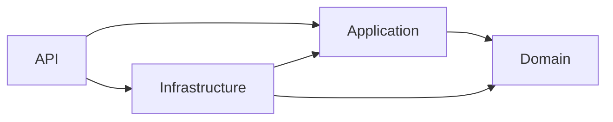
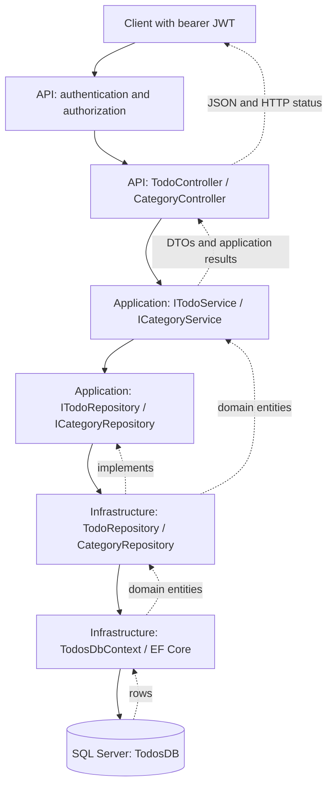
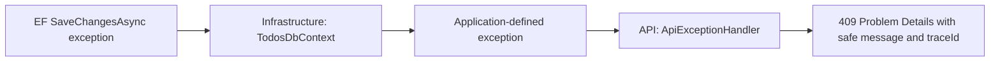

# Clean architecture and request workflows

The [main README](../README.md#clean-architecture) introduces the project layout, dependency diagram, and full happy path from Users API login through EF Core to the JSON response. This guide expands on the runtime boundaries and write/error behavior.

## Project references versus runtime calls

Source references point inward:



At runtime, calls travel outward toward persistence through interfaces defined by Application:



The Application project does not reference Infrastructure. DI connects each repository interface to its EF implementation. `Program.cs` calls `AddApplication()` and `AddInfrastructure(configuration)` once at startup; the container creates scoped services/repositories/context for each request. Domain entities have no framework dependencies. Application's only package dependency is the generic DI abstractions used for registration.

## Authentication and reading a page

1. The client authenticates with the external Users API (`POST /api/auth/login`), which returns `token.accessToken` and `userId`.
2. The client requests `GET /api/v1/todo?userId=1&pageNumber=1&pageSize=10` with an `Authorization: Bearer ...` header.
3. JWT middleware validates the signature, issuer, audience, and token lifetime locally. The fallback authorization policy requires an authenticated caller. No Users API call or users-database query occurs inside this service.
4. MVC binds `TodoPaginationQuery` and validates its Data Annotations. The controller forwards the query and request cancellation token to `ITodoService`.
5. `TodoService` calculates the offset, asks `ITodoRepository` for the filtered total count, then asks for the page.
6. `TodoRepository` builds LINQ queries using `AsNoTracking`, filters, deterministic sorting, and `Skip`/`Take`. EF Core translates and executes a count statement and a page statement sequentially against SQL Server.
7. EF materializes rows into `Todo` entities. The service maps those entities to `TodoDTO` and creates `PaginationMetadata`.
8. The controller returns `200 OK`; ASP.NET Core serializes `{ pagination, items }`.

The queries are separate statements, so concurrent writes can change the data between the count and page reads. An empty result/page is still a successful response. `userId` is a caller-supplied filter; the current application does not enforce ownership from JWT claims.

## Create, update, and delete

This example shows creating a todo after JWT and model validation have succeeded:

```mermaid
sequenceDiagram
    autonumber
    actor Client
    participant Controller as TodoController
    participant Service as TodoService
    participant Repo as TodoRepository
    participant EF as TodosDbContext / EF Core
    participant DB as SQL Server

    Client->>Controller: POST /api/v1/todo with a valid JWT and DTO
    Controller->>Service: CreateTodoAsync(dto, cancellationToken)
    Service->>Repo: CategoryExistsAsync(categoryId)
    Repo->>EF: Categories.AnyAsync
    EF->>DB: Check referenced category
    DB-->>EF: Category exists
    EF-->>Repo: true
    Repo-->>Service: true
    Service->>Service: Create Todo with defaults and UTC timestamps
    Service->>Repo: AddTodoAsync(todo)
    Repo->>EF: Track new entity with AddAsync
    Service->>Repo: SaveChangesAsync
    Repo->>EF: SaveChangesAsync
    EF->>DB: INSERT within the save transaction
    DB-->>EF: Generated TodoId
    EF-->>Repo: Changes saved; entity ID populated
    Repo-->>Service: Save completed
    Service-->>Controller: Result.Success with TodoDTO
    Controller-->>Client: 201 Created, Location header, and TodoDTO JSON
```

For PUT/PATCH, a repository loads a **tracked** entity with `FindAsync`. The service changes the permitted fields and timestamps, then saves. For DELETE, the repository marks the entity as deleted before saving. The repository does not choose HTTP status codes, and the controller does not manipulate EF state.

Category workflows follow the same boundaries. Category IDs are caller-assigned; the service checks for duplicates before creating. Todo creation/update checks the category reference but does not query a Users database. Deleting a category cascades to its todos through the SQL foreign key.

## Failure paths and exception boundaries

Expected application failures return `Result` / `Result<T>` with codes from `Errors`. `ControllerResultExtensions` maps validation, not-found, and conflict results to `400`, `404`, and `409` Problem Details. MVC handles Data Annotation failures before calling the service.

Unexpected persistence exceptions follow a separate path:



`TodosDbContext.SaveChangesAsync` translates `DbUpdateConcurrencyException` to `ConcurrencyConflictException` and other `DbUpdateException` instances to `PersistenceConflictException`. The original exception remains available as `InnerException` for server logs. The API handler depends on these application exceptions and emits the existing safe error messages. It never exposes SQL exception details to clients.

Cancellation exceptions propagate unchanged. Other unexpected failures reach the global handler and return `500` with a generic message. Authentication failures return `401` before the controller and may have an empty body.

There is no row-version/concurrency-token property in the current model. Translating EF concurrency exceptions preserves the error boundary; it does not add detection of every simultaneous edit.

## Testing the boundaries

Application unit tests replace repository interfaces and the clock. HTTP integration tests replace application services while retaining actual routing, model binding, authentication, authorization, and result serialization. Persistence-error tests use the actual SQL Server-configured EF context with a save interceptor that throws before any database access, then verify the API handler's Problem Details output.

A successful test run therefore validates these boundaries without requiring SQL Server. Real database connectivity, generated SQL, schema compatibility, and CRUD behavior require running the configured API against SQL Server, as described in the [README verification section](../README.md#verification-and-manual-requests).
